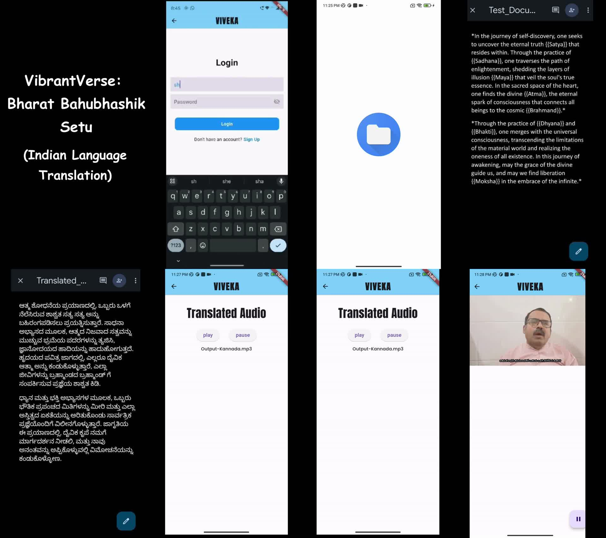
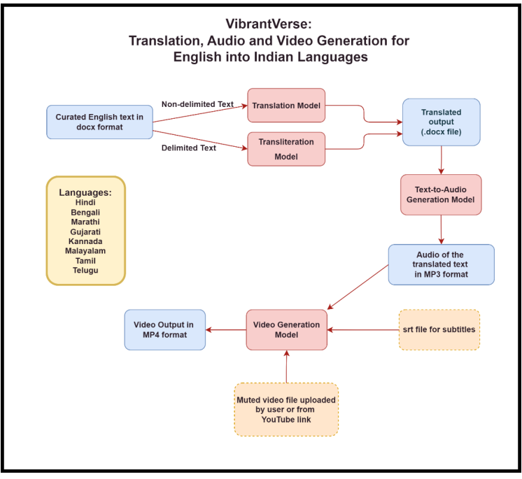
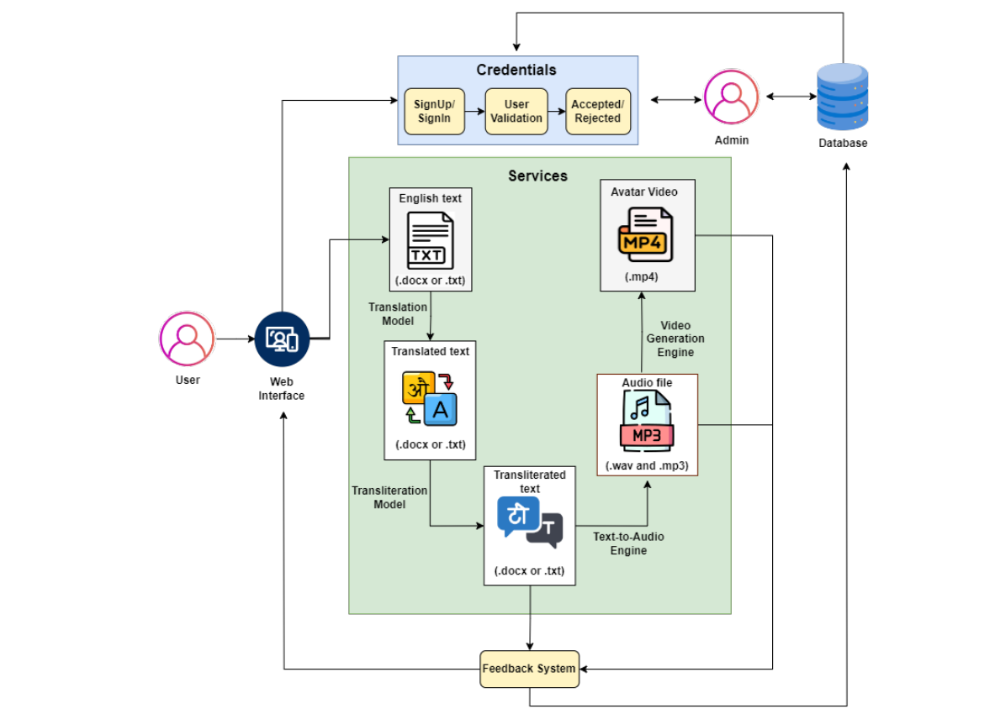

# VibrantVerse: Bharat Bahubhashik Setu
### English → Indian-language translation, transliteration, speech and lip-synced video

 

> **Recognition:** sponsored by the **Karnataka State Council for Science and Technology (KSCST)** under the 47th Series of
> the Student Project Programme 2023-24 (proposal ref. 47S_BE_1411). **Best Paper/Poster Presentation award** at the National
> Conference on Digital Technology & Engineering (**NCDTE-24**), and published in the Indiana Journal.
> Final-year B.E. (CSE) project, RV Institute of Technology and Management, Bengaluru (VTU), 2023-24.

India has 22 scheduled languages and hundreds more, yet most educational and public content is written in English.
**VibrantVerse** turns an English document into a **translated document, natural-sounding speech, and a lip-synced
avatar video with subtitles** in **8 Indian languages**: Hindi, Bengali, Marathi, Gujarati, Kannada, Telugu, Tamil and Malayalam.
It is aimed at learners, educators, and people with visual or hearing impairments.

Its distinctive feature is **culture-aware translation**. Domain-specific Sanskrit terms such as *Atma*, *Maya* or *Moksha*
are marked in the input and **transliterated** into the target script instead of being translated, because translation would
lose their meaning.

<p align="center"></p>
<p align="center"><i>Demo flow (Flutter app "VIVEKA"): login → curated English document → Kannada translation → audio → lip-synced avatar with subtitles.
Full demo video: <code>assets/demo.mp4</code></i></p>

## How it works
<p align="center"></p>

| Stage | Model / tool | What it does |
|---|---|---|
| 1. Parse | `python-docx`, regex | Reads the curated DOCX: `# headings #`, `*paragraphs*`, `{{Sanskrit terms}}` |
| 2. Translate | **IndicTrans** (AI4Bharat, Transformer trained on the 49.7M-pair **Samanantar** corpus) | English → target language, paragraph by paragraph |
| 3. Transliterate | **IndicXlit** (AI4Bharat, trained on the Aksharantar corpus) | `{{Atma}}` → ಆತ್ಮ / आत्मा / ... in the target script |
| 4. Speak | **IndicTTS** (AI4Bharat FastPitch + HiFi-GAN) | Male or female voice, WAV/MP3 |
| 5. Animate | **Wav2Lip** | Lip-syncs a user-supplied (muted) speaker video to the generated speech |
| 6. Subtitle | FFmpeg | Burns target-language subtitles into the MP4 |
| App | Flutter + Firebase, FastAPI backend | Authentication, upload, language/output selection, playback, feedback |

<details><summary><b>Full system architecture</b> (from the project report)</summary>
<p align="center"></p>
</details>

### Input format
```text
# The Inner Journey #
*In the journey of self-discovery, one seeks to uncover the eternal truth {{Satya}} that resides within ...*
```
Headings and paragraphs are translated. Each `{{term}}` passes through translation unchanged and is then transliterated, so
*"the eternal truth {{Satya}}"* becomes *"ಶಾಶ್ವತ ಸತ್ಯ **ಸತ್ಯ**"* in Kannada. A full example is in [`examples/sample_input.docx`](examples/sample_input.docx).

## Results (as reported in the project report)
BLEU on the project's curated English test documents (0–1 scale; higher is better):

| Language | Google Translate | GPT-3.5 | **VibrantVerse (IndicTrans pipeline)** |
|---|---|---|---|
| Hindi | **0.735** | 0.418 | 0.678 |
| Bengali | 0.095 | 0.092 | **0.349** |
| Marathi | **0.467** | 0.164 | 0.462 |
| Gujarati | 0.524 | 0.247 | **0.599** |
| Kannada | **0.724** | 0.149 | 0.721 |
| Telugu | 0.527 | 0.475 | 0.527 |
| Tamil | 0.474 | 0.433 | 0.474 |
| Malayalam | **0.351** | 0.343 | 0.350 |
| **Mean** | 0.487 | 0.290 | **0.520** |

* The pipeline **beats GPT-3.5 in all 8 languages** and has the **highest mean BLEU**. Against Google Translate it is better in Bengali and Gujarati, equal in Telugu and Tamil, and within 0.005 in Marathi, Kannada and Malayalam; Google clearly leads only in Hindi.
* *Caveats:* the test documents were small and domain-specific (spiritual/philosophical text), and scores are corpus BLEU, which is
  sensitive to the references used. They are not results on a standard benchmark. A re-evaluation on FLORES-200 with sacreBLEU/chrF++ is
  listed under future work.

## Repository layout
```
notebooks/   01_translation_transliteration.ipynb  02_text_to_speech.ipynb  03_lipsync_video_subtitles.ipynb
             (the original Google Colab notebooks used in the project; outputs cleared)
src/vibrantverse/
             document.py   curated-DOCX parsing (order-preserving), {{term}} handling, DOCX writing
             models.py     IndicTrans / IndicXlit / IndicTTS / Wav2Lip / FFmpeg wrappers (lazy imports)
             subtitles.py  valid SRT generation from the translated text (no ASR needed), ASR fallback
             pipeline.py   end-to-end pipeline + CLI
tests/       unit tests for the parts that don't need GPUs or checkpoints (run in CI)
examples/    sample_input.docx
assets/      diagrams, demo storyboard (and demo.mp4)
docs/SETUP.md  how to install the models (Colab recommended)
```

## Quick start
The models need a GPU and several GB of checkpoints, so **Google Colab (T4) is recommended**. See [`docs/SETUP.md`](docs/SETUP.md).
```bash
python -m vibrantverse.pipeline translate --input examples/sample_input.docx --lang kn --out out/kn.docx
python -m vibrantverse.pipeline speak     --input out/kn.docx --lang kn --gender female --out out/kn.mp3
python -m vibrantverse.pipeline video     --face my_speaker.mp4 --audio out/kn.wav --text out/kn.docx --out out/kn.mp4
```
Tests for the GPU-free parts: `pip install -r requirements-dev.txt && pytest -q`.

## What changed in this cleaned-up release (v1.1)
The original notebooks are kept unchanged in `notebooks/`. The `src/` package refactors them and fixes issues found in review:
* **Document order:** headings and paragraphs were extracted separately and zipped back together, which scrambles documents with several paragraphs per heading. Parsing is now order-preserving.
* **Subtitles:** timestamps were written as `0:00:05,000` (invalid SRT), and speech recognition was hard-coded to Hindi for every language. Subtitles are now generated directly from the known translated text, with valid `HH:MM:SS,mmm` timestamps; the ASR fallback uses the correct language.
* **Audio:** float → 16-bit PCM conversion now clips to avoid wrap-around distortion on loud samples.
* Hard-coded Colab paths and `input()` prompts are replaced by a CLI, and language codes are validated.

## Future work
* Benchmark evaluation (FLORES-200, chrF++/COMET) and a comparison with **IndicTrans2**, which supports all 22 scheduled languages.
* Automatic detection of Sanskrit/Indic terms, so manual `{{...}}` markup isn't needed.
* Streaming TTS, and avatar generation without a source video.

## Team
**Aashish Ramana S · Aditi Umesh Nayak · Palvisha Changkakati · Pranshu Sinha**. Guide: **Dr. Roopashree S**, Dept. of CSE, RVITM Bengaluru.

## Acknowledgements and licences
This project builds on open models by **[AI4Bharat](https://ai4bharat.iitm.ac.in/)**
([IndicTrans](https://github.com/AI4Bharat/indicTrans), [IndicXlit](https://github.com/AI4Bharat/IndicXlit),
[Indic-TTS](https://github.com/AI4Bharat/Indic-TTS)) and on [Wav2Lip](https://github.com/Rudrabha/Wav2Lip). Each is
governed by its own licence. **Wav2Lip and its checkpoints are for research and non-commercial use only.** The code in this
repository is released under the MIT licence (see `LICENSE`). Thanks to KSCST for sponsoring the project.

<sub>References: Ramesh et al., *Samanantar* (TACL 2022); Madhani et al., *Aksharantar* (Findings of EMNLP 2023);
Kumar et al., *Towards Building Text-to-Speech Systems for the Next Billion Users* (ICASSP 2023); Prajwal et al., *Wav2Lip* (ACM MM 2020).</sub>
